# Architecture (as of Milestone 1)

## Request flow

```mermaid
flowchart LR
    C[Client] -->|POST /v1/completions| S[server.py<br/>auth, rate limit,<br/>validation, caps]
    S -->|tokenize + submit| E[engine.py<br/>bounded FIFO]
    E -->|one at a time| W[worker thread<br/>backend.generate&#40;&#41;]
    W -->|call_soon_threadsafe| H[RequestHandle<br/>asyncio.Queue of events]
    H -->|TokenEvent / FinishEvent| S
    S -->|JSON or SSE| C
    S -.->|cancel&#40;&#41; on disconnect,<br/>cancel endpoint, deadline| H
    H -.->|threading.Event| W
```

1. **server.py** authenticates (bearer key, if configured), applies the per-client token bucket,
   validates the body (pydantic, `extra="forbid"`), enforces `max_tokens` cap, prompt
   character/token caps and the context window, then tokenizes on the event loop. All rejections
   happen **before** a request is queued, so even `stream=true` requests get proper 4xx codes.
2. **engine.submit** creates a `RequestHandle` and puts it in an unbounded `asyncio.Queue`; the
   admission check is on *in-flight* handles (running + waiting ≤ `MAX_PENDING + 1`), so cancelled
   requests free capacity immediately.
3. The **engine loop** (an asyncio task) pops handles FIFO and runs each on a single-thread
   `ThreadPoolExecutor`. One thread ⇒ the model is never executed concurrently.
4. The **worker** pulls tokens from the backend's lazy iterator, detokenizes incrementally, and
   posts `TokenEvent`s back to the loop with `call_soon_threadsafe`. Request state is only ever
   mutated on the loop thread.
5. The handler consumes `handle.events()` and either accumulates a JSON response or writes SSE
   chunks.

## Backends

| Backend | Purpose | Notes |
|---|---|---|
| `toy` | Tests and scheduling experiments | Byte tokenizer; echoes the prompt then EOS; per-token sleeps simulate prefill/decode cost. No torch. |
| `tiny` | Exercise the real torch path in CI | 2-layer random GPT-2 over the byte tokenizer; no download. |
| `hf` | Real model | `AutoModelForCausalLM` at a pinned revision; default SmolLM2-135M-Instruct. |

The `hf` backend's generation is a hand-written loop: one prefill forward (`logits_to_keep=1`),
then one decode forward per token with `past_key_values`. **The KV cache is Transformers'
`DynamicCache` — this is integration with the library's cache, not an original cache
implementation.** The loop is tested to produce exactly `model.generate()`'s greedy output.
Sampling (greedy / temperature / top-p) runs on CPU over the final-position logits with a
per-request `torch.Generator`, so a fixed `seed` reproduces output on the same device/dtype.

## Cancellation and timeouts

Cancellation is cooperative at token granularity:

| Trigger | Mechanism |
|---|---|
| Streaming client disconnects | `_SSEResponse.__call__` wraps Starlette's streaming in `try/finally: handle.cancel()`. (Relying on the body generator's own `finally` is not enough: if it is parked at a `yield` when Starlette cancels the send, it is only closed later by GC.) |
| Non-streaming client disconnects | A watcher task awaits the next ASGI `receive()`; after the body is read, the only possible message is `http.disconnect`. |
| `POST /v1/requests/{id}/cancel` | Looks up the in-flight handle and cancels it. |
| Deadline (`timeout_s`, capped by `REQUEST_TIMEOUT_S`) | Covers queue wait + generation. Enforced in three places: the engine loop skips expired queued requests, the worker checks before/after each step, and the consumer's `wait_for` fires on time even if the worker is stuck inside a long forward pass. |
| Shutdown | `engine.stop()` cancels everything and waits for the worker to leave the model. |

`handle.cancel()` on a queued request finishes it immediately; on a running request it sets a
`threading.Event`. The worker checks the flag **before** each forward pass (no extra compute
after cancel) and **after** it (a step that completes after cancel/deadline is discarded, so the
client sees `cancelled`/`timeout` rather than a late token or EOS — this second check was added
after a real-model run exposed the bug; see PLAN.md progress log).

**Limitation:** a forward pass that has started cannot be interrupted. Worst case is the prefill
of a long prompt; on the overloaded test machine a 6-token prefill took ~14 s on MPS. Under
normal conditions this bounds cancel latency at one decode step.

Each request emits exactly one `FinishEvent`; `_push` ignores anything after it, so a
consumer-side timeout and a late worker finish cannot both be delivered.

## Streaming detokenization

Byte-level BPE can split one character across tokens, and some tokenizers drop the leading space
when a token is decoded alone. `IncrementalDetokenizer` uses the windowed scheme from TGI/vLLM:
decode `ids[prefix_offset:]`, emit only the suffix beyond the previously decoded window, and hold
output while it ends in U+FFFD. Tests verify concatenated deltas equal a full decode on both the
byte tokenizer (random multi-byte strings) and the real SmolLM2 tokenizer.

## Lifecycle

`lifespan` starts model loading as a background task so the HTTP server comes up immediately:
`/healthz` is 200 (liveness), `/readyz` and completions are 503 until load **and warmup** finish.
Warmup runs 4 greedy decode steps so the first real request's TTFT excludes one-time
kernel/allocator setup. If loading fails, `/healthz` turns 503 so an orchestrator restarts the
process. Backends injected by the caller (tests) are not closed by the app; loaded ones are.

## Design decisions and trade-offs

- **OpenAI-compatible wire format** — enables apples-to-apples load testing against vLLM later;
  cost: extension fields live under a `miniserve` key and nonstandard finish reasons.
- **Thread + iterator instead of async model code** — PyTorch calls block; one worker thread
  keeps the event loop responsive and gives a single place to check cancellation. M3 will replace
  "one request per iterator" with a batched step function, keeping the event/handle interface.
- **Reject rather than clamp `max_tokens` above the cap** — explicit errors are easier to reason
  about in benchmarks than silent truncation.
- **Tokenize on the event loop** — bounded by `MAX_PROMPT_CHARS`; fast tokenizers take ~ms.
  Moving it off-loop is a candidate if profiling shows loop stalls.
- **Admission by request count only** — M2 will add token/memory-based admission and fairness.
  Today one long request blocks everything behind it (head-of-line blocking), by design of M1.
- **Rate-limit key is client IP** — with a single shared API key there is no better identity;
  behind a proxy all clients share one bucket (documented limitation).

## Known limitations (M1)

- Strict FIFO, one request at a time: no batching, no fairness, head-of-line blocking.
- Forward passes are not interruptible (cancel/timeout latency ≥ current step).
- No `/metrics` yet (M2/M7); per-request timings are in responses and in a log line.
- No chat template / `/v1/chat/completions`, stop strings, logprobs or `n>1`.
- CUDA code paths (device/dtype selection) are written but untested — no CUDA GPU available.
- A Python `resource_tracker` "leaked semaphore" warning is printed at process exit; not yet
  investigated (appears after torch/tokenizers use; no functional impact observed).
