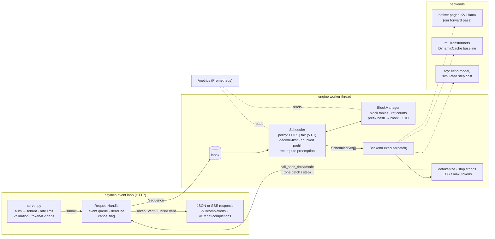
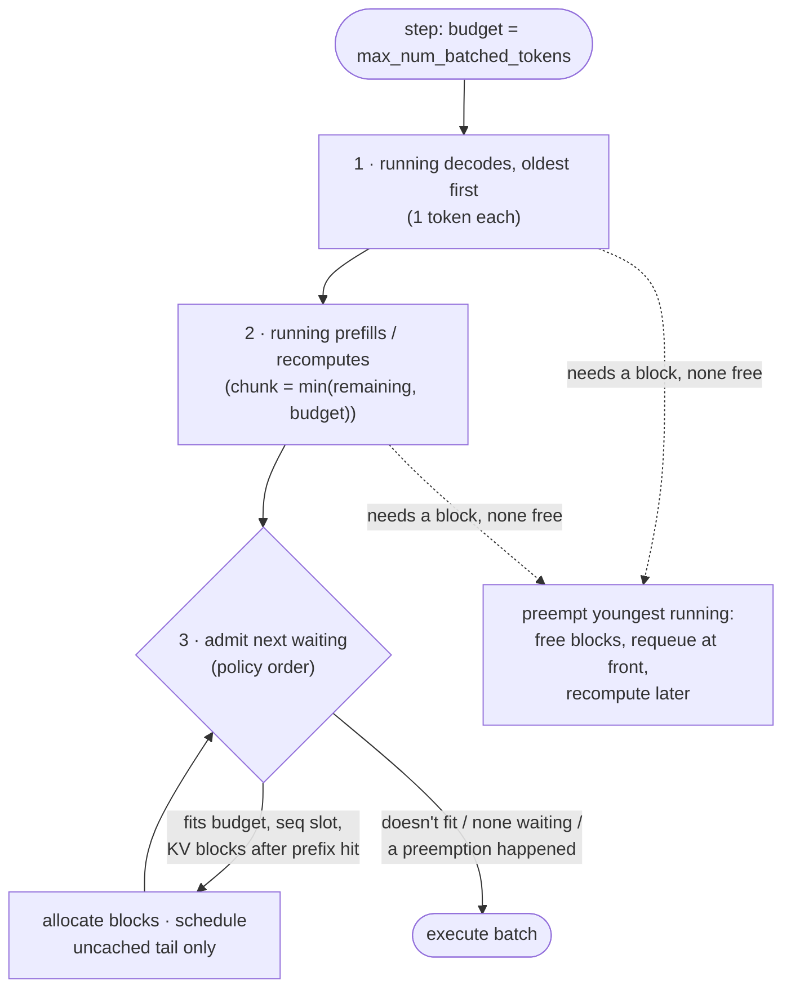

# Architecture

MiniServe is a single-process server: an asyncio HTTP front end and one engine worker thread
that owns the model, the KV cache and the scheduler. Everything that decides *what runs when*
is plain Python (testable without a GPU); everything that touches tensors lives in a backend.



## Request lifecycle

1. **Admission (event loop).** Bearer key → tenant (`MINISERVE_API_KEYS="alice:k1,bob:k2"`),
   token-bucket rate limit per tenant, pydantic validation (unknown fields → 422), caps on
   prompt characters/tokens, `max_tokens`, context window and *KV capacity* (a request that
   could never fit is a 400, not a stuck queue entry). Then backpressure: total in-flight ≤
   `max_num_seqs + max_waiting`, per-tenant waiting ≤ `max_waiting_per_tenant`, queued prompt
   tokens ≤ `max_queued_tokens`; overflow → 503 (global) or 429 (tenant) with `Retry-After`.
2. **Queueing.** The handle's `Sequence` goes into a locked inbox; the worker drains it at the
   start of each step into the policy's waiting queue.
3. **Scheduling (every step).** See below. Admitted sequences get KV blocks (reusing cached
   prefix blocks), a "started" notification is posted *before* the step runs.
4. **Execution.** `backend.execute(batch)` runs one forward pass over all scheduled spans and
   samples a token for each span that reaches the end of its sequence.
5. **Post-processing.** Discard tokens of sequences cancelled/expired during the step; check EOS
   (unless `ignore_eos`), incremental detokenization, stop strings, `max_tokens`. Events for the
   whole step go back to the loop in one `call_soon_threadsafe`.
6. **Finish.** Blocks are freed (full blocks stay in the prefix cache), per-sequence backend
   state is released, the handle emits exactly one `FinishEvent`, metrics are recorded.

## Scheduler: one step



* **Decode-first.** Decodes are scheduled before prefill chunks so that a long prompt arriving
  cannot stall tokens already streaming (Sarathi-Serve's "stall-free" batching).
* **Chunked prefill.** A prompt larger than the remaining budget is split across steps. Trade-off
  measured in BENCHMARK.md: lower inter-token latency for everyone else, slightly higher TTFT for
  the long prompt itself.
* **No skipping ahead.** Admission stops at the first waiting sequence that doesn't fit, so the
  policy's order is respected (a big request is not starved by a stream of small ones).
* **Preemption by recompute.** When decoding sequences outgrow the KV cache, the youngest is
  evicted and later recomputed (prompt + tokens generated so far). Streamed tokens are never
  retracted; its sampler keeps its RNG stream so seeded output is unchanged; with prefix caching
  most of the recompute is a cache hit.
* **Fair policy (VTC).** Each tenant has a counter of weighted tokens served (input ×1,
  output ×2, recompute not billed); the next admission comes from the backlogged tenant with
  the smallest counter. A tenant returning from idle is lifted to the current minimum so idle
  time cannot be banked.

## Paged KV cache and prefix caching (original implementation)

```
physical cache, per layer:  [ num_blocks × block_size slots ] × kv_heads × head_dim
                              ┌──────┬──────┬──────┬──────┬──────┬───
                              │ b0   │ b1   │ b2   │ b3   │ b4   │ ...
                              └──────┴──────┴──────┴──────┴──────┴───
seq A block table:  [b0, b1, b3]      token p → slot  table[p // B] * B + p % B
seq B block table:  [b0, b1, b4]      (b0, b1 shared: same system prompt, ref count 2)
```

* `BlockManager` hands out fixed-size blocks; sequences grow one block at a time instead of
  reserving `max_tokens` up front, so memory use tracks actual length.
* Each **full** block gets a chained hash: `blake2b(parent_hash ‖ token_ids)`. Chaining means a
  block's identity covers its entire prefix; a 128-bit cryptographic hash (not Python's `hash`)
  because a collision would silently serve another prompt's K/V.
* On admission the longest run of cached blocks is reused (ref count + 1) and only the tail is
  computed; at least one token is always recomputed to produce logits.
* Freed blocks keep their contents in an LRU *evictable* pool and are only wiped when a fresh
  block is needed. Sequences are freed tail-first, so the shared head of a prompt is evicted
  last.
* Shared blocks are full and immutable — sequences only append into their private last block —
  so no copy-on-write is required.
* Invariants (every block is exactly one of free / evictable / in use; ref counts equal live
  block-table references; hash map consistent) are asserted after every operation in a
  600-step randomized test and in every engine-level test.

## Native backend: our forward pass

`backends/native.py` takes the weights from a Transformers Llama/Qwen2/Mistral checkpoint and
runs its own forward pass:

* Projections and MLP run on the **flattened ragged batch** `[total_tokens, hidden]`, so mixing a
  700-token prefill chunk with 30 single-token decodes wastes no compute on padding. QKV and
  gate/up projections are fused into one GEMM each.
* **Attention** gathers each sequence's K/V from its block table into a padded tensor and calls
  `scaled_dot_product_attention` with a boolean mask (causal within the new span, full over the
  cached context, nothing past the sequence's length). One metadata build per step is shared by
  all layers.
* RoPE uses a precomputed cos/sin table built exactly like Transformers'; RMSNorm matches its
  fp32-upcast order. Result: logits match Transformers within 2e-5 (fp32) for full prompts,
  chunked prefill, mixed batches and prefix-cache hits; greedy outputs on the real SmolLM2 are
  token-identical to the Transformers backend.
* Optional **int8 weight-only quantization** (W8A16, per-output-channel scales) through
  `torch._weight_int8pack_mm` on CPU/MPS; a tied LM head and embedding share one int8 tensor.

**Honest gap to vLLM's PagedAttention.** The gather materializes `[batch, max_context]` K/V per
layer per step instead of reading blocks in place inside a fused kernel, and Python launches
~25 ops per layer per step. That is why a single-sequence decode step here costs tens of ms on an
M4 GPU while the model's FLOPs would allow far less, and why batch 64 is slower than batch 32 in
our profile. A Triton/Metal kernel, CUDA graphs or `torch.compile` are the next steps; none is
claimed here.

## Backends at a glance

| | `native` | `hf` | `toy` |
|---|---|---|---|
| Model code | ours (Llama family) | Transformers, any causal LM | echo, no torch |
| KV cache | paged, shared blocks | one `DynamicCache` per sequence (library) | none |
| Batched forward | yes (ragged) | no — sequences run one by one within a step | simulated cost |
| Prefix caching | yes | no | yes (affects simulated cost) |
| Purpose | the engine | integration baseline at matched model/hardware | scheduling tests & experiments |

## Concurrency, cancellation, deadlines

| Trigger | Mechanism |
|---|---|
| Streaming client disconnects | `_SSEResponse.__call__` cancels in `finally` (the body generator alone is not enough: if parked at a `yield` it is only closed by GC) |
| Non-streaming client disconnects | watcher task awaits the next ASGI `receive()` (`http.disconnect`) |
| `POST /v1/requests/{id}/cancel` | looks up the in-flight handle |
| Deadline (`timeout_s` ≤ `REQUEST_TIMEOUT_S`) | covers queue + generation; enforced by the worker (before/after each step) **and** by the consumer's `wait_for`, so the client gets its timeout on time even during a long step |
| Shutdown (SIGTERM) | readiness fails and new requests get 503 (drain), uvicorn waits up to `DRAIN_TIMEOUT_S` for in-flight streams, then the engine cancels the rest |

A forward pass that has started cannot be interrupted; cancellation latency is at most one step.
Each request produces exactly one `FinishEvent` (later events are dropped by the handle).

## Observability

* `GET /metrics` — Prometheus: request counters by finish reason, rejections by reason,
  histograms for TTFT, queue time, E2E, time per output token, step duration, batch size in
  sequences and tokens; gauges for running/waiting, KV usage and blocks (used / cached-free /
  total), prefix-cache hit rate, preemptions, process RSS and device memory. Names follow vLLM's
  where an equivalent exists.
* `GET /v1/engine` — live scheduler/KV state as JSON (debugging, demos).
* Structured logs: `key=value` text or JSON lines (`MINISERVE_LOG_FORMAT=json`); every finished
  request logs id, tenant, reason, token counts, cached tokens, preemptions and timings.
* `/healthz` (liveness: process up, load not failed, engine thread alive) and `/readyz`
  (readiness: loaded, warmed up through the real batched path, not draining).

## Known limitations

* Single process, single device; no tensor/pipeline parallelism, no multi-LoRA, no speculative
  decoding, no logprobs, `n=1` only.
* Attention is gather-based PyTorch, not a fused paged kernel (see above).
* Batch invariance is not guaranteed: a sequence's logits can differ in the last bits depending
  on what it is batched with (different GEMM shapes). Seeded sampling is still per-request
  deterministic in our tests, but near-tie tokens could flip — the same caveat applies to vLLM.
* CUDA paths (device/dtype selection) are written but untested: no NVIDIA GPU was available.
* Rate limits and queues are in-memory and per process.
