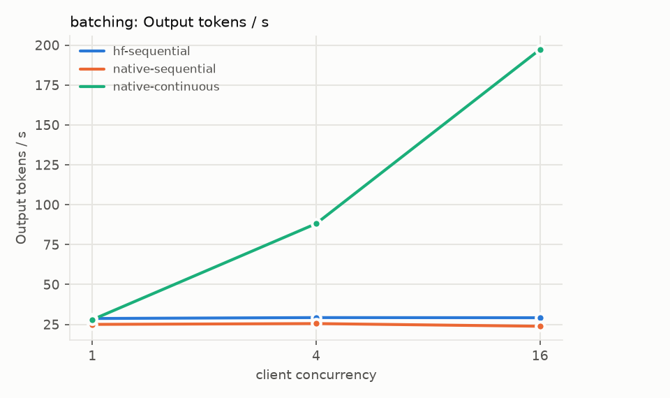
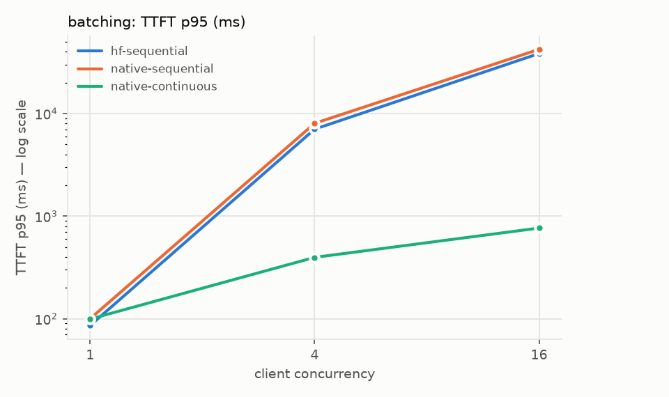
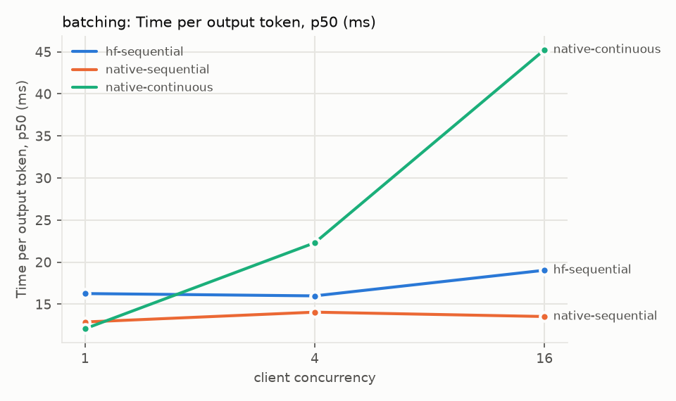
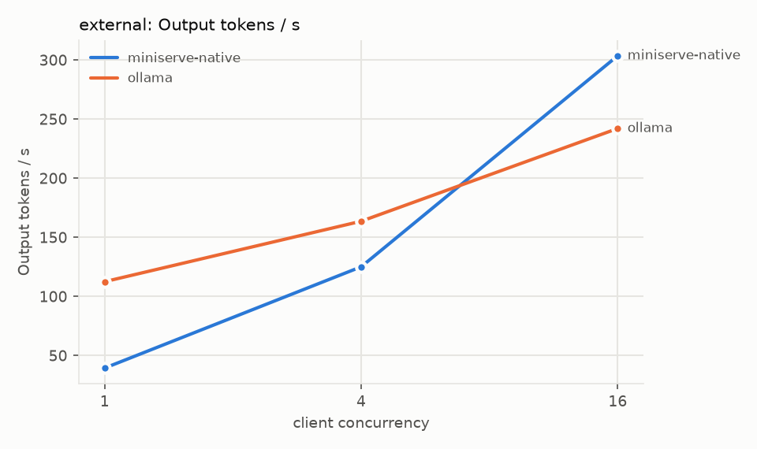

# Benchmarks

Everything here was produced by scripts in this repository, on one machine, and the raw data is
committed under `results/`. Nothing is extrapolated. The comparison to mature engines at the end
is explicitly caveated.

## TL;DR (SmolLM2-135M-Instruct, Apple M4 GPU via MPS, fp16)

| Question | Measured answer |
|---|---|
| Continuous batching vs one-request-at-a-time (16 clients) | **197 vs 24–29 output tok/s** (6.8–8.3×); median TTFT **0.46 s vs 32–38 s**; per-token latency 35 → 73 ms |
| Is our forward pass slower than Transformers for one stream? | parity to ~9% slower: TPOT 36–38 ms (ours) vs 35 ms (Transformers) at concurrency 1; run-to-run noise ~5% |
| Head-of-line blocking behind long generations | chat TTFT p50 **13.5 s → 87 ms** |
| Long prompts stalling running streams | chunked prefill cuts chat ITL p95 **663 → 163 ms**; long prompts' own TTFT +29% |
| Prefix caching (1,024-token shared system prompt) | TTFT p50 **671 → 75 ms**, throughput **3×**, 94% of prompt tokens from cache, peak KV 18% → 5% |
| Fairness (heavy tenant: 12 in flight, light: 1; 4 slots) | VTC: light tenant TTFT p50 **4.6 → 2.1 s**, 8 → 14 completions per round; total throughput unchanged |
| int8 weight-only quantization | weights **257 → 129 MB**, perplexity 14.617 → 14.610 (unchanged), 96.9% top-1 agreement; single-stream decode **13% faster** |
| Ollama (llama.cpp + Metal) on the same Mac | 1 client: Ollama **~3× faster** (112 vs 39 tok/s). 16 clients: MiniServe **304 vs 242 tok/s**, TTFT p50 238 vs 477 ms (wide spread) |
| Two kernel-level optimizations tried | **both slower on MPS** (fused RMSNorm/RoPE +3–19%; `torch.compile` ~25×) — not merged |

## Setup and methodology

* **Hardware.** Apple M4 (10 CPU cores, 10-core GPU, 16 GB unified memory), macOS 15.3.2,
  Python 3.12.10, torch 2.14.1, transformers 5.19.0. No NVIDIA GPU was available.
* **A shared, busy machine.** Several other projects ran heavy jobs at the same time (load
  average 10–20 during these runs; 90+ earlier in the day). Every benchmark ran under a lease
  from the machine's resource manager (`-g 1 -c 2 -m 3`), and each result file records the
  manager's status and the load average before/after. Absolute numbers on a quiet machine will
  be better; the comparisons are what these runs are for.
* **Robust comparisons.** Each suite runs every configuration once per round, rotating the order
  between rounds (A B C, B C A, …) so slow drift in background load does not favour whichever runs
  first. Tables show the **median across rounds** with the min–max spread for headline cells.
* **Client-side measurement.** `miniserve-bench` streams every request and timestamps chunks.
  TTFT = request sent → first non-empty text chunk; ITL = gaps between text chunks; TPOT =
  (E2E − TTFT)/(output tokens − 1). Server-side `/metrics` is sampled every 0.5 s for peak RSS,
  KV usage, queue depth, mean batch size, step time and preemptions.
* **Controlled workloads.** Prompts are built to an exact token count with the model's own
  tokenizer, each with a unique random head (no accidental prefix sharing unless a scenario asks
  for it). `ignore_eos` forces exact output lengths so every config does the same work.
  Greedy decoding throughout.
* **Matched settings.** Within a suite only the variable under study changes; model, revision,
  device, dtype, KV budget (512 MB) and workload are identical.
* **Reproduce.** `uv run miniserve-bench suite bench/suites/<name>.json --out results/<name>/run1`
  then `uv run miniserve-bench report results/<name>/run1 --charts docs/img/bench`.

## Why batching helps on this hardware: step latency

`bench/profile_step.py` times one engine step directly (no HTTP), median of 20, 2 interleaved
rounds, MPS fp16, 256 tokens of context per sequence (`results/profile/ab-baseline-r*.json`):

| decode batch | step time | tokens / s |
|---:|---:|---:|
| 1 | 13.4–15.8 ms | 63–75 |
| 8 | 29.4–30.5 ms | 262–272 |
| 32 | 61.2–62.1 ms | 515–523 |
| prefill, 256 tokens | 45–53 ms | 4,900–5,700 |

A decode step for 32 sequences costs ~4× a single-sequence step but produces 32× the tokens:
small-model decoding here is dominated by fixed per-step cost (kernel launches), so batching
converts almost-free capacity into throughput. The Transformers per-sequence path cannot exploit
this (its cost grows linearly with the number of sequences).

An earlier profile taken under heavier contention (load 21) is kept in
`results/profile/mps-float16.json`; it shows the same shape with ~2× higher absolute times and an
outlier at batch 1 — the reason later numbers come from interleaved repeated runs. On CPU (fp32,
4 threads, `cpu-float32.json`) a single stream is faster than on MPS (51 vs 86 ms per step in the
same contended period) but batch-32 throughput is lower (133 vs 250 tok/s): the GPU wins once
there is concurrency.

## M3 — continuous batching vs sequential (suite `batching`)

Closed-loop clients, prompt 128 tokens, 64 output tokens. `hf-sequential` = Transformers with its
own `DynamicCache`, one request at a time (the M1 design); `native-sequential` = our engine with
`max_num_seqs=1`; `native-continuous` = our engine, up to 32 sequences per step. Prefix caching off.
2 rounds; raw data `results/batching/run1/`.

| concurrency | config | out tok/s | TTFT p50 (ms) | TTFT p95 | TPOT p50 | E2E p95 | mean batch |
|---:|---|---:|---:|---:|---:|---:|---:|
| 1 | hf-sequential | 28.7 | 67 | 86 | 34.7 | 2,461 | 1.0 |
| 1 | native-sequential | 25.0 | 75 | 100 | 37.9 | 2,953 | 1.0 |
| 1 | native-continuous | 28.0 | 71 | 99 | 35.9 | 2,480 | 1.0 |
| 4 | hf-sequential | 29.3 | 5,942 | 7,038 | 32.8 | 9,568 | 1.0 |
| 4 | native-sequential | 25.5 | 7,453 | 8,021 | 38.4 | 10,431 | 1.0 |
| 4 | native-continuous | **88.1** | **265** | 396 | 43.4 | 3,338 | 3.9 |
| 16 | hf-sequential | 29.2 | 32,409 | 38,436 | 33.6 | 40,526 | 1.0 |
| 16 | native-sequential | 23.8 | 38,314 | 42,218 | 39.9 | 44,805 | 1.0 |
| 16 | native-continuous | **197.3** | **463** | 765 | 73.2 | 5,986 | 15.3 |

**Reading it.** One-at-a-time serving is flat at ~25–29 tok/s regardless of load, so queueing
delay explodes (TTFT 32–38 s at 16 clients). Continuous batching scales throughput with load
(6.8× the Transformers baseline at 16 clients) and keeps TTFT sub-second. The trade-off is per-
token latency: each step now carries 15 sequences, so TPOT doubles (35 → 73 ms). At concurrency 1
our engine is at parity to ~9% slower per token than Transformers (35.9–37.9 vs 34.7 ms). The two
native configs do identical work at concurrency 1 yet differ by 5%, which is the noise floor of
these runs; to the extent the gap is real, our per-step metadata construction and gather-based
attention cost a little more than HF's contiguous cache when there is nothing to batch.

## M2/M3 — head-of-line blocking (suite `hol`)

Native engine; prefix caching off; 2 rounds; per-tenant medians (`results/hol/run1/`).

**Decode HOL.** Tenant *batch* keeps 3 long generations (64 → 192 tokens) in flight; tenant
*chat* sends short requests (32 → 16 tokens) as a Poisson process at 0.3 req/s for 60 s.

| config | chat TTFT p50 | chat TTFT p95 | chat E2E p95 | batch out tok/s | total out tok/s |
|---|---:|---:|---:|---:|---:|
| fifo-sequential (`max_num_seqs=1`) | 13,451 ms | 15,827 ms | 16,176 ms | 31.9 | 35.4 |
| continuous, chunked prefill | **87 ms** | 263 ms | 1,604 ms | 80.9 | 84.5 |
| continuous, unchunked | **75 ms** | 216 ms | 1,153 ms | 81.2 | 84.1 |

Under FIFO every short chat request waits for whole 192-token generations ahead of it; with
iteration-level scheduling it joins the running batch at the next step. (Chunking makes no
difference here: prompts are short.)

**Prefill HOL.** Tenant *docs* keeps 2 requests with **1,500-token prompts** (4 output tokens) in
flight; tenant *chat* keeps 2 streams of 96 output tokens going, for 45 s.

| config | chat ITL p95 | chat TPOT p50 | chat TTFT p50 | docs TTFT p50 | docs TTFT p95 | step ms (mean) |
|---|---:|---:|---:|---:|---:|---:|
| fifo-sequential | 73 ms | 24 ms | 3,133 ms | 5,318 ms | 13,938 ms | 33 |
| continuous, **chunked** (256-token budget) | **163 ms** | **131 ms** | 554 ms | 1,150 ms | 1,287 ms | 117 |
| continuous, unchunked (whole prompt per step) | 663 ms | 237 ms | 130 ms | 891 ms | 1,178 ms | 253 |

Without chunking, every step that admits a docs request runs a 1,500-token prefill (~0.5–0.65 s)
and every streaming chat token waits for it: chat ITL p95 = 663 ms. Chunked prefill caps the
prefill work per step at 256 tokens, so decodes keep flowing (ITL p95 163 ms, 4× better; TPOT
1.8× better) — paid for by the long prompts themselves (docs TTFT p50 +29%). This is the
Sarathi-Serve trade-off, measured. FIFO gives the chat stream the best ITL once it runs but
makes it wait seconds to start.

*Sample-size caveat:* the chat tenant completes only 2–6 requests per round in the continuous
configs (each 96-token answer takes 13–23 s while docs prefills dominate), so its ITL/TPOT
percentiles rest on ~190–570 inter-token gaps per round, but its TTFT on few requests.

## M4 — prefix caching (suite `prefix`)

Every request = the same **1,024-token system prompt** + a unique ~24-token question, 16 output
tokens; 4 closed-loop clients, 24 requests; continuous batching on in both configs; 2 rounds
(`results/prefix/run1/`).

| config | TTFT p50 | TTFT p95 | TPOT p50 | E2E p95 | out tok/s | req/s | prompt tokens from cache | peak KV usage | mean step |
|---|---:|---:|---:|---:|---:|---:|---:|---:|---:|
| prefix cache off | 671 ms | 947 ms | 92.7 ms | 2,446 ms | 30.4 | 1.90 | 0% | 18% | 106 ms |
| prefix cache **on** | **75 ms** | **220 ms** | **40.9 ms** | **805 ms** | **90.1** | **5.63** | **94%** | **5%** | 41 ms |

With the cache on, each request computes only its ~24-token tail plus at least one token of the
last block (the first request in a burst still pays the full prefill; concurrent identical
prefixes admitted in the same step are not deduplicated). Effects compound: TTFT drops 9×,
throughput triples, and — because steps no longer carry 1,000-token prefills for other
requests — the per-token latency of everyone else halves. KV memory falls too: the shared prompt
occupies its 64 blocks once, referenced by every running request, instead of once per request.
Correctness of hits is covered by tests (cache-hit outputs are identical to cold outputs on tiny
models and on the real model).

## M2 — fairness (suite `fairness`)

Capacity limited to **4 running sequences** so a queue forms. Tenant *heavy* keeps 12 requests in
flight, tenant *light* keeps 1 (64 → 64 tokens each), separate API keys, 60 s; 2 rounds
(`results/fairness/run1/`).

| policy | light TTFT p50 | light TTFT p95 | light E2E p95 | light requests / round | light share of tokens served | heavy TTFT p50 | total out tok/s |
|---|---:|---:|---:|---:|---:|---:|---:|
| FCFS | 4,609 ms | 6,677 ms | 8,974 ms | 7–8 | 7.0–7.1% | 4,809 ms | 104.8 |
| fair (VTC) | **2,135 ms** | **2,723 ms** | **5,316 ms** | 13–14 | 11.6–12.0% | 4,961 ms | 110.6 |

VTC more than halves the light tenant's waiting time and almost doubles what it gets done, at no
cost in total throughput and a ~3% TTFT cost for the heavy tenant. Why is the light tenant's TTFT
still ~2 s rather than near zero? The scheduler is work-conserving: when a slot frees, waiting
heavy requests fill it *in the same step*, a few milliseconds before the light tenant's next
closed-loop request arrives. VTC can only favour a tenant that is actually waiting, so the light
tenant moves from "behind ~2 waves of the heavy backlog" (FCFS) to "next wave" (each wave here is
~64 steps × ~33 ms ≈ 2.1 s). Reserving capacity for absent tenants (non-work-conserving) or
preempting on arrival would shrink that further at a throughput cost — not implemented.

A toy-backend demonstration over HTTP with real tenant keys is `examples/multi_tenant.sh`: a
tenant arriving behind another tenant's 12-request backlog waited 6.75 s for its first token under
FCFS and 2.1 s under VTC.

## M5 — int8 weight-only quantization (suite `quant` + `bench/eval_quant.py`)

W8A16: every projection and the (tied) LM head/embedding stored as int8 with per-output-channel
fp32 scales, multiplied through PyTorch's fused `_weight_int8pack_mm` on MPS; norms, biases and
the KV cache stay fp16. 2 rounds at a clean commit (`results/quant/run2/`, `quality.json`).

**Quality** (teacher-forced over `bench/data/eval_text.txt`, 547 tokens, vs Transformers fp32):

| variant | perplexity | top-1 agreement with fp32 | mean KL(fp32 ‖ variant) | weights |
|---|---:|---:|---:|---:|
| Transformers fp32 (reference) | 14.615 | — | — | — |
| native fp32 (CPU) | 14.615 | 100.0% | 0.00000 | 513 MB |
| native fp16 (MPS) | 14.617 | 99.6% | 0.00002 | 257 MB |
| native fp16 + **int8 weights** (MPS) | 14.610 | 96.9% | 0.0036 | **129 MB** |

**Speed and memory** (prompt 128, 64 output tokens):

| clients | config | out tok/s | TPOT p50 | TTFT p50 | peak RSS |
|---:|---|---:|---:|---:|---:|
| 1 | fp16 | 47.0 | 20.1 ms | 42 ms | 680 MB |
| 1 | fp16 + int8 weights | **55.1** | **17.5 ms** | 43 ms | **425 MB** |
| 16 | fp16 | 368.8 | 41.1 ms | 205 ms | 569 MB |
| 16 | fp16 + int8 weights | **382.4** | **38.9 ms** | 211 ms | **487 MB** |

(The evaluation text is small — 547 tokens, written for this repo — enough to catch a broken
kernel or a large quality regression, not to resolve sub-1% perplexity differences.)

Half the weight memory, perplexity unchanged within noise, ~3% of next-token argmaxes flip, and
decoding gets 13% faster for a single stream (fewer bytes of weights to read per step) and 4%
faster at 16 clients (where the step is less weight-bandwidth-bound).

**How the first run failed.** The first `quant` run produced 64 tokens per request but *no text*:
every int8 request emitted token 0. A bisect of the original code against single-change variants,
on the exact benchmark prompts, found two compounding bugs: the int8 capability probe used a weight
shape the MPS kernel rejects (N, K must be multiples of 32), so MPS silently used the dequantize
fallback — which multiplied by raw int8 values before scaling and overflowed fp16 into NaN logits.
Two other plausible explanations were tested and refuted along the way (fused-kernel overflow;
fp16-subnormal scales). The broken run's numbers were discarded; the fix and its regression tests
are in commit `ef398fd` (TESTING.md bug #10).

## M5 — external comparison: Ollama on the same Mac

Same workload against **Ollama 0.14.2** (llama.cpp with Metal kernels) serving the same model in
the same precision (`smollm2:135m-instruct-fp16`), run as a **private instance** on port 11435
(`OLLAMA_NUM_PARALLEL=16`, other settings default) so a shared system Ollama was neither used nor
disturbed (`bench/run_ollama_comparison.sh`). Ollama cannot force output length, so *both*
servers were driven as plain OpenAI clients (greedy, natural EOS): mean output 60–64 tokens for
both, 128-token prompts. 2 rounds (`results/external-ollama/run1/`).

| clients | server | out tok/s | TTFT p50 | TTFT p95 | TPOT p50 | E2E p95 |
|---:|---|---:|---:|---:|---:|---:|
| 1 | MiniServe (native, fp16) | 39.4 | 48 ms | 127 ms | 24.5 ms | 1,763 ms |
| 1 | **Ollama** | **112.5** | 79 ms | 90 ms | **8.1 ms** | **610 ms** |
| 4 | MiniServe | 125.1 (102–149) | 143 ms | 268 ms | 27.5 ms | 2,267 ms |
| 4 | **Ollama** | **163.6** (145–183) | 149 ms | 202 ms | 21.5 ms | 1,785 ms |
| 16 | **MiniServe** | **303.6** (247–360) | **238 ms** | 706 ms | **48.2 ms** | **3,775 ms** |
| 16 | Ollama | 242.1 (229–256) | 477 ms | 606 ms | 59.8 ms | 5,379 ms |

**Reading it.** For a single stream Ollama is ~3× faster: 8 ms vs 25 ms per token is the price of
MiniServe's ~1,200 PyTorch kernel launches per step against llama.cpp's fused Metal kernels.
Under load the picture flips: with 16 concurrent clients MiniServe's continuous batching delivered
more throughput and half the median TTFT. MiniServe's spread at 16 clients is wide (247–360 tok/s
across the two rounds), so "comparable to somewhat ahead" is the defensible statement, not "faster".

**Caveats (why this is not a verdict on Ollama).** Default Ollama settings apart from
`NUM_PARALLEL` (no tuning of context size, batch size or flash attention); Ollama's OpenAI-
compatible endpoint applies its own prompt handling; output lengths are close but not identical;
token counts for Ollama streams come from its chunks; the shared machine was busy; two rounds
only. vLLM requires CUDA; `bench/suites/external-vllm.json` is a ready-to-run template for a CUDA
host and has **not** been executed.

## Bottlenecks and optimization log

**Where the time goes.** `torch.profiler` on one decode step (CPU, batch 1 and 16): ~1,820–1,910
ATen calls per step, of which ~1,240–1,280 do work (the rest are views) — about 41 per layer
for 30 layers. On MPS each kernel launch costs tens of microseconds, so a 135M-parameter model
spends most of a single-sequence step on launch overhead rather than math. That is why batching
is so effective here, and why single-stream speed is roughly at parity with Transformers rather
than better.

**Attempt 1 — fewer kernels (not merged).** Fused the RMSNorm into `F.rms_norm` (kept the fp32
upcast so results stay bit-identical to Transformers) and applied RoPE to Q and K in one pass.
Kernel-launching ATen calls per step dropped **1,239 → 845 (−32%)**, all numerics tests passed —
and the step got **slower** on MPS: +19% at batch 1, +3% at 8, +8% at 32 (median of 2 interleaved
rounds; `results/profile/ab-fused-vs-baseline.txt`, patch in `fused-rmsnorm-rope.patch`).
Probable causes: the Q|K slice-and-reshape forces an extra copy, and `F.rms_norm` with explicit
casts is not a single kernel on MPS. Lesson: kernel counts are a proxy; only wall-clock counts.

**Attempt 2 — `torch.compile(dynamic=True)` (not merged).** Compiled the whole step on MPS:
4 graphs, no graph breaks, 2–4 minutes of first-call compilation — and the compiled step ran
**~25× slower** than eager (331 vs 13 ms at batch 1; `results/profile/torch-compile-mps.txt`).
Inductor's MPS backend is not competitive for this workload in torch 2.14.

**What would actually help** (not attempted): a fused paged-attention kernel that reads K/V
blocks in place (removes the per-layer gather of `[batch, context]` K/V and several launches),
fused norm/RoPE/activation kernels written for Metal or Triton, and graph capture (CUDA graphs on
NVIDIA). These are exactly what vLLM and llama.cpp have and MiniServe does not.

## Threats to validity

* Shared machine: background load varied between and within runs. Rotation + medians reduce
  bias, not noise; spreads are shown. A unit-test run (1 core) overlapped part of the `hol` suite.
* Two rounds per suite: enough to see large effects (2× and up), not to resolve differences of a
  few percent.
* Client and server share the machine (the client's CPU use competes with the server).
* One small model (135M). Larger models shift the balance from launch overhead to memory
  bandwidth and compute; the qualitative scheduling results should hold, the ratios will not.
* Git state: the `batching` run was taken at `be441d8` with uncommitted changes limited to the
  dashboard endpoints, docs and tests (engine, scheduler, block manager and backends unchanged —
  verified with `git diff`).
