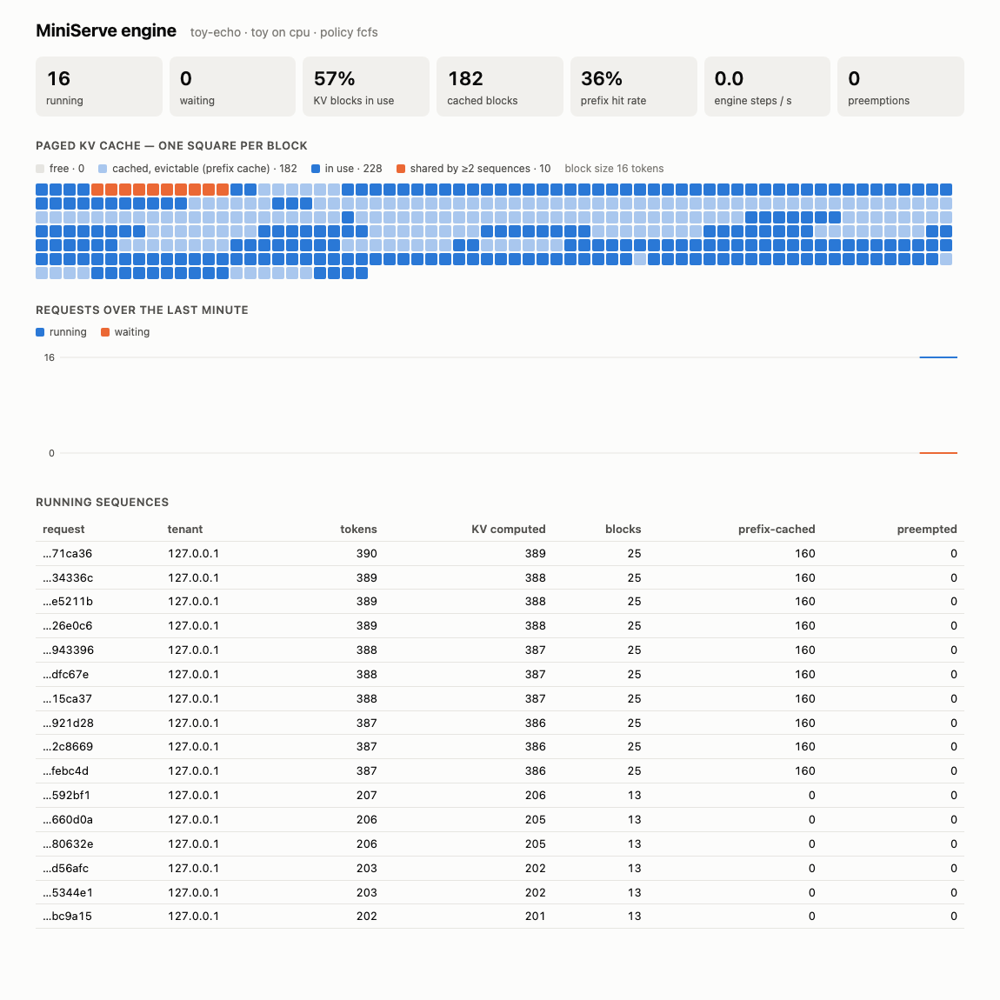
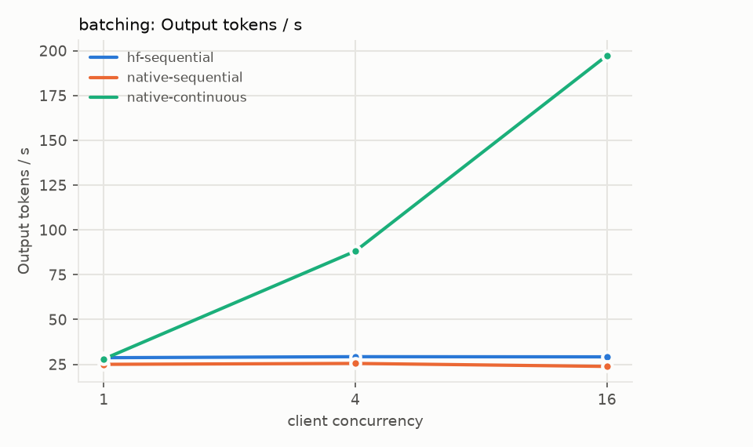

# MiniServe

**A small LLM inference server with a real continuous-batching engine: paged KV cache, automatic
prefix caching, chunked prefill, preemption, fair scheduling, speculative decoding, streaming,
and a benchmark harness that measures all of it.** Built to make the ideas behind vLLM-style serving visible, testable
and measurable on a laptop — not to beat vLLM.



<sub>`/dashboard` under load: one square per KV block. Orange blocks hold a 160-token system
prompt that ten running requests share by reference; light-blue blocks are finished requests'
prefixes kept in an LRU cache for reuse.</sub>

## What's inside

| | |
|---|---|
| **Own forward pass on a paged KV cache** | Llama/Qwen2/Mistral weights from Hugging Face, our ragged-batch forward (fused QKV and gate/up, gather-based paged attention, RoPE/RMSNorm matched to Transformers). Logits match Transformers within 2e-5; greedy output on SmolLM2 is **token-identical** to the Transformers backend. |
| **Continuous batching** | Iteration-level scheduler under a token budget: decode-first, chunked prefill, recompute preemption when the KV cache runs out. |
| **Automatic prefix caching** | Chained blake2b block hashes, ref-counted sharing, LRU eviction of cached-free blocks, invariant-checked by randomized tests. |
| **Speculative decoding** | n-gram (prompt-lookup) drafts verified in the same batched pass; greedy output token-identical, sampling distribution-preserving (rejection rule, tested statistically); switches itself off for large batches. |
| **Fairness & backpressure** | FCFS or Virtual Token Counter (OSDI'24) per tenant; per-tenant API keys, rate limits and queue limits; bounded queues by request count *and* queued tokens; KV-capacity validation up front. |
| **Production plumbing** | OpenAI-compatible `/v1/completions` + `/v1/chat/completions` (works with the official `openai` SDK), SSE streaming with held-back stop strings, cancellation on disconnect, deadlines, Prometheus `/metrics`, JSON logs, readiness/liveness, graceful drain on SIGTERM, Docker, CI. |
| **Measurement** | `miniserve-bench`: exact-length prompts, closed-loop and Poisson multi-tenant workloads, A/B suites with rotated config order, TTFT/TPOT/ITL/E2E percentiles, server-side batch/KV/memory sampling, Markdown + charts. |
| **Int8 weight-only quantization** | W8A16 with per-channel scales through PyTorch's fused int8 matmul on CPU/MPS, with a quality evaluation. |

## Results (SmolLM2-135M, Apple M4 GPU via MPS, fp16)

Measured with `miniserve-bench` on a **shared, busy laptop** (other jobs running; load average
recorded with every run); medians of 2 rounds with rotated order. Full tables, spreads, caveats:
[BENCHMARK.md](BENCHMARK.md).

| Question | Answer (measured) |
|---|---|
| Does continuous batching pay off? | At 16 concurrent clients: **197 vs 29 output tok/s** (6.8× the Transformers one-at-a-time baseline), median TTFT **0.46 s vs 32 s**; per-token latency rises from ~35 to ~73 ms |
| Short requests stuck behind long generations? | chat TTFT p50 **13.5 s (FIFO) → 87 ms** (continuous batching) |
| Long prompts stalling streams that are already running? | chunked prefill: chat inter-token p95 **663 → 163 ms**, at +29% TTFT for the long prompts themselves |
| Shared 1,024-token system prompt (prefix caching)? | TTFT p50 **671 → 75 ms**, 3× throughput, 94% of prompt tokens served from cache |
| One tenant flooding the server? | fair (VTC) scheduling: the light tenant's TTFT p50 **4.6 → 2.1 s**, its completions 8 → 14 per round, total throughput unchanged |
| Is our forward pass slower than Transformers for one stream? | parity to ~9% slower (36–38 vs 35 ms per token at concurrency 1; run-to-run noise ~5%) |
| int8 weight-only quantization? | weights 257 → 129 MB, perplexity unchanged (14.62 → 14.61), single-stream decode 13% faster |
| How does it compare with Ollama (llama.cpp + Metal) on the same Mac? | One stream: Ollama is **~3× faster** (fused Metal kernels vs ~1,200 PyTorch launches per step). 16 clients: MiniServe **304 vs 242 tok/s** and half the median TTFT — comparable-to-ahead, wide spread; caveats in BENCHMARK.md |
| Did kernel-level tweaks help? | No — fused RMSNorm/RoPE (−32% kernel calls) ran 3–19% *slower* on MPS; `torch.compile` ~25× slower. Documented, not merged. |



## Quickstart

Requires Python ≥ 3.11 and [uv](https://docs.astral.sh/uv/).

```bash
make install                 # uv sync --extra hf --extra bench
make test                    # 190 tests, no downloads, CPU only (+5 opt-in real-model)
MINISERVE_API_KEY=demo-key uv run miniserve        # SmolLM2-135M on MPS/CUDA/CPU (auto)
open http://127.0.0.1:8000/dashboard
```

```bash
curl -s localhost:8000/v1/chat/completions -H 'Authorization: Bearer demo-key' \
  -H 'Content-Type: application/json' \
  -d '{"messages":[{"role":"user","content":"What is the capital of France?"}],"max_tokens":32}'
```

```python
from openai import OpenAI   # the official SDK works unchanged
client = OpenAI(base_url="http://127.0.0.1:8000/v1", api_key="demo-key")
for chunk in client.chat.completions.create(
        model="HuggingFaceTB/SmolLM2-135M-Instruct", stream=True,
        messages=[{"role": "user", "content": "Write a haiku about caches."}]):
    print(chunk.choices[0].delta.content or "", end="", flush=True)
```

No download? `MINISERVE_BACKEND=toy` (deterministic echo model with a simulated cost model) or
`MINISERVE_BACKEND=tiny` (random 2-layer Llama on the real engine).

## API

| Endpoint | Auth | Notes |
|---|---|---|
| `POST /v1/completions`, `POST /v1/chat/completions` | yes | `max_tokens` (`max_completion_tokens`), `temperature`, `top_p`, `seed`, `stop` (≤4), `stream`, `stream_options`, `user`; extensions `ignore_eos` (vLLM name), `timeout_s`. Unknown fields → 422. |
| `POST /v1/requests/{id}/cancel` | yes | id from the `X-Request-ID` header; only the owning tenant |
| `GET /v1/models`, `GET /v1/engine`, `GET /v1/engine/blocks` | yes | model; live scheduler/KV state; per-block map |
| `GET /metrics` | no | Prometheus (TTFT, TPOT, queue, E2E, step time, batch size, KV usage, prefix hit rate, preemptions, memory) |
| `GET /healthz`, `GET /readyz`, `GET /dashboard` | no | liveness, readiness (503 while loading/draining), live dashboard |

`finish_reason` is `stop`, `length`, or MiniServe's `cancelled` / `timeout`. Responses carry
`usage.prompt_tokens_details.cached_tokens` and server-side timings under `miniserve`.

## Configuration (environment, see [.env.example](.env.example))

| Variable | Default | |
|---|---|---|
| `MINISERVE_BACKEND` | `native` | `native` (our engine) · `hf` (Transformers baseline) · `toy` · `tiny` |
| `MINISERVE_MODEL_ID` / `_REVISION` | SmolLM2-135M-Instruct @ pinned SHA | any Llama/Qwen2/Mistral for `native`, any causal LM for `hf` |
| `MINISERVE_DEVICE` / `_DTYPE` | `auto` | cuda → mps → cpu; fp16 on GPU, fp32 on CPU |
| `MINISERVE_MAX_NUM_SEQS` | 32 | running batch size |
| `MINISERVE_MAX_NUM_BATCHED_TOKENS` | 512 | per-step token budget (chunk size for long prompts) |
| `MINISERVE_KV_CACHE_MB` / `_BLOCK_SIZE` | 256 / 16 | paged KV cache size and block size |
| `MINISERVE_ENABLE_PREFIX_CACHING` / `_CHUNKED_PREFILL` | true / true | |
| `MINISERVE_SCHEDULING_POLICY` | `fcfs` | or `fair` (Virtual Token Counter per tenant) |
| `MINISERVE_SPECULATIVE` / `_NUM_SPECULATIVE_TOKENS` | `none` / 4 | `ngram`: prompt-lookup speculative decoding (native/toy backends) |
| `MINISERVE_SPEC_MAX_BATCH` | 4 | speculate only while at most this many sequences decode |
| `MINISERVE_PREFIX_CACHE_SCOPE` | `global` | `tenant`: never share cached blocks across tenants |
| `MINISERVE_QUANTIZATION` | `none` | `int8` weight-only (native backend) |
| `MINISERVE_API_KEY` / `_API_KEYS` | – | single key, or `tenant:key,...` for multi-tenant |
| `MINISERVE_MAX_WAITING` / `_PER_TENANT` / `MAX_QUEUED_TOKENS` | 256 / 64 / 262144 | backpressure |
| `MINISERVE_REQUEST_TIMEOUT_S` / `_DRAIN_TIMEOUT_S` | 120 / 30 | |

Safety: binds `127.0.0.1` by default and **refuses to start on a public address without an API
key**; per-tenant rate limits and token caps are on by default. Still: put it behind a real
gateway (TLS, auth) before exposing it.

## How it works

[ARCHITECTURE.md](ARCHITECTURE.md) has the diagrams: request lifecycle, the per-step scheduling
algorithm, the paged KV layout and prefix-cache hashing, the threading model, and an honest gap
analysis against vLLM's PagedAttention kernels.

```
src/miniserve/
  server.py         FastAPI app: auth/tenancy, limits, completions + chat, SSE, probes, dashboard
  engine.py         asyncio front end + worker thread step loop, cancellation, deadlines, admission
  scheduler.py      continuous batching: decode-first, chunked prefill, preemption
  policy.py         FCFS and Virtual Token Counter fair queueing
  block_manager.py  paged KV allocator + automatic prefix caching
  speculative.py    n-gram draft proposer for speculative decoding
  backends/         native (our paged Llama), hf (Transformers baseline), toy
  sampling.py  detokenizer.py  stop.py  metrics.py  ratelimit.py  logging_setup.py
  bench/            load generator, suites, reports
bench/              suite definitions, step profiler, quantization quality eval
```

## Documentation

| | |
|---|---|
| [ARCHITECTURE.md](ARCHITECTURE.md) | design, diagrams, trade-offs, limitations |
| [BENCHMARK.md](BENCHMARK.md) | methodology, all results, bottleneck analysis, comparison caveats |
| [TESTING.md](TESTING.md) | test layers, what each proves, mutation checks, bugs found |
| [PLAN.md](PLAN.md) | milestones, acceptance criteria, non-goals, progress log |
| [docs/DEMO.md](docs/DEMO.md) | walkthrough with captured output |
| [LICENSE_NOTES.md](LICENSE_NOTES.md) | model/dependency licenses, papers the ideas come from |

## What this is not

Not a vLLM/TGI/llama.cpp replacement: no fused attention kernels, CUDA graphs, tensor
parallelism, draft-model/EAGLE speculation, LoRA, logprobs or multi-node anything. Single-stream speed is
bounded by Python kernel-launch overhead (~900 kernel launches per decode step); the point is
the scheduling and memory-management machinery around the model, built and measured in the open.
