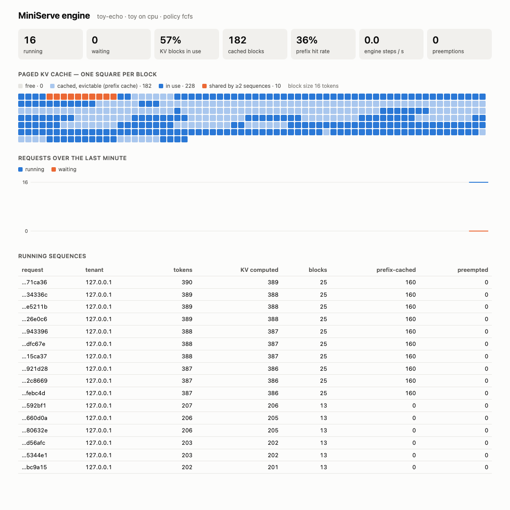

# Demo walkthrough

Everything below was run on 2026-10-15 and copied from the captured output (long JSON lightly
trimmed with `…`). The real-model sections use SmolLM2-135M-Instruct on the M4 GPU (MPS, fp16) on
a shared, busy machine — decode speeds here (~11 tok/s for a single stream) reflect that
contention, not the engine; see BENCHMARK.md for controlled measurements. The captures ran on
ports 8126/8127 (to avoid other services on the machine); commands are shown with the default
port 8000.

## 1. Start it

```console
$ MINISERVE_API_KEYS="alice:demo-key,bob:bob-key" uv run miniserve
$ curl -s localhost:8000/readyz | python3 -m json.tool
{
    "status": "ready",
    "backend": "native",
    "model": "HuggingFaceTB/SmolLM2-135M-Instruct",
    "device": "mps",
    "dtype": "float16",
    "load_s": 19.558,
    "active_requests": 0,
    "version": "0.1.0"
}
```

`/readyz` is 503 while the model loads and warms up (two short requests through the real batched
path) and again while draining; `/healthz` is liveness. A non-loopback `MINISERVE_HOST` without a
key makes the server exit with code 2 ("Refusing to bind …").

## 2. Chat completion (OpenAI-compatible)

```console
$ curl -s localhost:8000/v1/chat/completions -H 'Authorization: Bearer demo-key' \
    -H 'Content-Type: application/json' \
    -d '{"messages":[{"role":"user","content":"What is the capital of France? Answer in one sentence."}],
         "max_tokens":40,"temperature":0}'
{
    "id": "cmpl-363ba40c6f5b4d73b940eb1d",
    "object": "chat.completion",
    "model": "HuggingFaceTB/SmolLM2-135M-Instruct",
    "choices": [{"index": 0,
                 "message": {"role": "assistant", "content": "The capital of France is Paris."},
                 "finish_reason": "stop", "logprobs": null}],
    "usage": {"prompt_tokens": 42, "completion_tokens": 7, "total_tokens": 49,
              "prompt_tokens_details": {"cached_tokens": 0}},
    "miniserve": {"timings": {"queue_ms": 0.398, "ttft_ms": 153.502, "total_ms": 812.343,
                              "decode_tokens_per_s": 10.63}, "preemptions": 0, "error": null}
}
```

The official SDK works unchanged: `uv run python examples/openai_chat.py "your question"`.

## 3. Streaming, held-back UTF-8 and stop strings

Toy backend (echoes its prompt one byte-token at a time), so every delta is visible:

```console
$ curl -sN localhost:8000/v1/completions -H "Content-Type: application/json" \
    -d '{"prompt": "héllo 🙂 then STOP here", "stream": true, "stop": ["STOP"]}'
delta 'h'  delta 'é'  delta 'l'  delta 'l'  delta 'o'  delta ' '  delta '🙂'  delta ' '
delta 't'  delta 'h'  delta 'e'  delta 'n'  delta ' '  delta '' finish_reason=stop
data: [DONE]
```

`é` (2 byte-tokens) and `🙂` (4) arrive as whole characters; `S`, `ST`, `STO` were held back
because they could still become `STOP`, and the stop string itself is never sent.

## 4. Prefix caching on the real model

Two chat requests sharing a long system prompt ("You are a meticulous assistant for a hardware
store …"):

```console
first request:   usage: {'prompt_tokens': 84, 'completion_tokens': 48, 'prompt_tokens_details': {'cached_tokens': 0}}
second request:  usage: {'prompt_tokens': 83, 'completion_tokens': 48, 'prompt_tokens_details': {'cached_tokens': 64}}
```

64 of the second request's 83 prompt tokens (4 full 16-token blocks) were served from the cache.
With a prompt this short TTFT barely changes (134 vs 138 ms — a step's fixed cost dominates); with
a 1,024-token shared prompt the benchmark measured TTFT 671 → 75 ms.

## 5. Cancel a running request

```console
$ curl -sN -D headers.txt localhost:8000/v1/completions … -d '{"prompt":"Write a long story about a lighthouse keeper.","max_tokens":400,"stream":true}' > stream.txt &
$ curl -s -X POST localhost:8000/v1/requests/$(grep -i x-request-id headers.txt | …)/cancel -H 'Authorization: Bearer demo-key'
{"id":"cmpl-d2f063f3857c4d459fd79a57","cancelled":true,"state":"running"}
$ tail stream.txt
data: {… "choices": [{"index": 0, "text": "", "finish_reason": "cancelled", …}], "usage": {"prompt_tokens": 9, "completion_tokens": 22, …}}
data: [DONE]
```

Generation stopped after 22 of 400 tokens. Closing the connection has the same effect (tested with
real sockets).

## 6. Engine state, metrics, logs

```console
$ curl -s localhost:8000/v1/engine -H 'Authorization: Bearer demo-key'
{
 "backend": "native", "device": "mps", "dtype": "float16", "steps": 137,
 "running": 0, "waiting": 0, "preemptions": 0,
 "kv_cache": {"block_size": 16, "blocks_total": 728, "blocks_used": 0, "blocks_cached": 16,
              "prefix_caching": true, "prefix_queried_tokens": 239, "prefix_hit_tokens": 64,
              "evictions": 0},
 "memory": {"kv_cache_bytes": 268369920, "weights_bytes": 269030016,
            "device_allocated_bytes": 678113536, "device_driver_bytes": 1133215744}
}
$ curl -s localhost:8000/metrics | grep -E '^miniserve_(requests_total|prefix_cache_hit_rate|…)'
miniserve_requests_total{finish_reason="stop"} 2.0
miniserve_requests_total{finish_reason="length"} 2.0
miniserve_requests_total{finish_reason="cancelled"} 1.0
miniserve_time_to_first_token_seconds_count 5.0
miniserve_generation_tokens_total 130.0
miniserve_kv_cache_usage_ratio 0.0
miniserve_prefix_cache_hit_rate 0.26778242677824265
```

Every finished request produces one structured log line (`MINISERVE_LOG_FORMAT=json`):

```json
{"level": "INFO", "logger": "miniserve.engine", "msg": "request finished",
 "request_id": "cmpl-d2f063f3857c4d459fd79a57", "tenant": "alice", "reason": "cancelled",
 "prompt_tokens": 9, "completion_tokens": 22, "cached_tokens": 0, "preemptions": 0,
 "queue_ms": 1.258, "ttft_ms": 57.769, "total_ms": 2079.992, "decode_tokens_per_s": 10.93}
```

## 7. Live dashboard

Open `http://127.0.0.1:8000/dashboard` (it asks for the API key if one is set). Under load it shows
every KV block — free, cached for reuse, in use, or shared by several sequences — plus queues,
prefix hit rate and the running sequences:



## 8. Fair scheduling between tenants

`examples/multi_tenant.sh` (toy backend, 4 running slots): Alice floods the server with 12 requests,
then Bob sends one.

```console
$ MINISERVE_SCHEDULING_POLICY=fcfs examples/multi_tenant.sh | grep BOB
     BOB  queue     6713 ms   ttft     6753 ms
$ MINISERVE_SCHEDULING_POLICY=fair examples/multi_tenant.sh | grep BOB
     BOB  queue     2066 ms   ttft     2105 ms
```

## 9. Graceful shutdown

```console
$ kill -TERM <pid>
{"level": "INFO", "logger": "miniserve", "msg": "draining", "active": 0}
{"level": "INFO", "logger": "uvicorn.error", "msg": "Shutting down"}
{"level": "INFO", "logger": "uvicorn.error", "msg": "Finished server process [95315]"}
```

In-flight streams are allowed to finish (up to `MINISERVE_DRAIN_TIMEOUT_S`) while readiness fails
and new requests get 503 — covered by a test that sends a real SIGTERM mid-stream.

## 10. Benchmark it yourself

```console
$ uv run miniserve-bench suite bench/suites/toy-batching.json --out results/toy/mine     # ~2 min, no download
$ uv run miniserve-bench report results/toy/mine --charts results/toy/mine/charts
$ uv run miniserve-bench suite bench/suites/batching.json --out results/batching/mine    # real model, ~25 min
```
